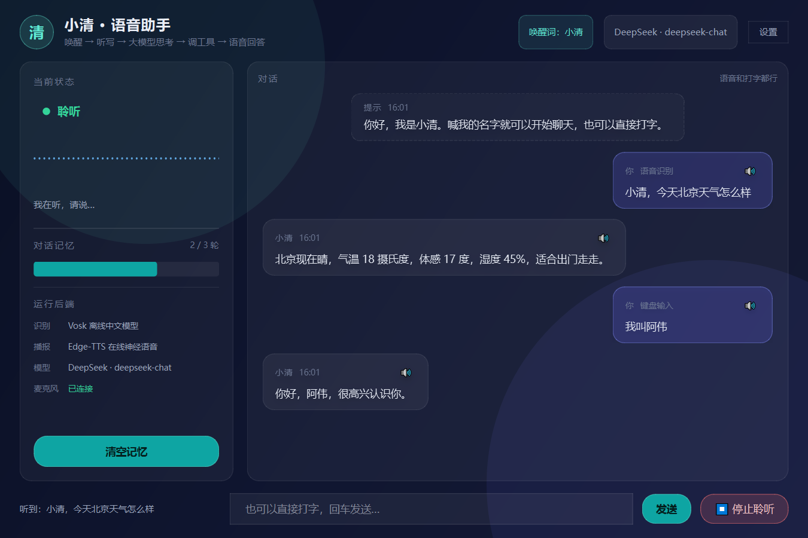
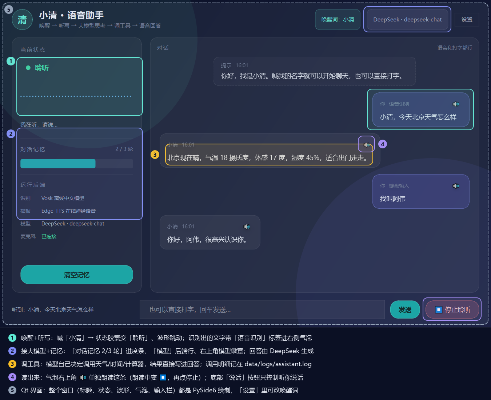
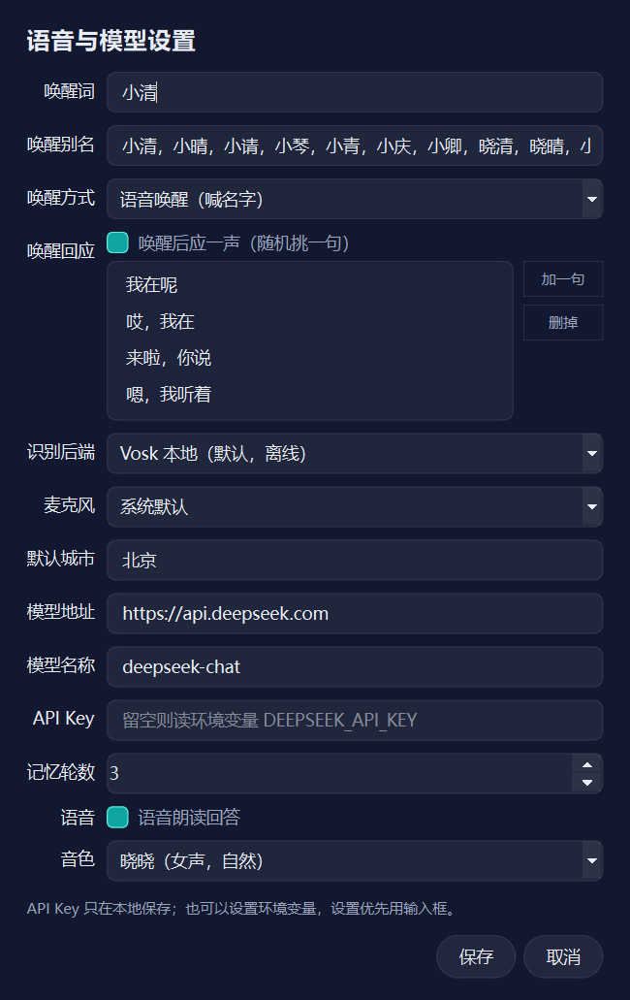

# 小清 · 桌面语音助手（Qt + 本地识别 + 大模型 + 工具调用）

按考题要求做的一个"带界面的语音助手"，五件事全部落地：

| # | 题目要求 | 本项目的做法 |
|---|---------|-------------|
| 1 | 唤醒 + 听写：喊名字唤醒，语音转中文 | 16k 麦克风采集 + 能量 VAD 切句 + **本地 Vosk 中文模型**识别；识别文本里匹配唤醒词即唤醒，别名 + 模糊匹配兜底；唤醒后先应一声（可关、可改）再进入聆听 |
| 2 | 接大模型：记住最近 3 轮对话 | DeepSeek（OpenAI 兼容协议）流式无关的 chat 调用；`ConversationMemory` 定长队列保存最近 3 轮 user/assistant |
| 3 | 调工具：模型自己判断，并执行 | 标准 function calling：`get_weather` / `get_current_time` / `calculate`，Agent 负责"调工具→回填结果→再问一次"的循环，最多 3 轮 |
| 4 | 读出来 + 显示：TTS 朗读，界面显示对话 | Edge-TTS 神经语音，失败自动退静默（SAPI 需在配置里显式指定）；气泡里同时显示文字和工具调用轨迹，每条都能单独点喇叭重读 |
| 5 | Qt 界面：识别结果、回复、状态 | PySide6 深色界面：状态胶囊（待唤醒/聆听/思考/说话）、实时波形、对话气泡、记忆进度、设置面板 |



> 上图是最新界面：左侧状态/波形/后端信息，右侧对话气泡；工具调用明细写日志，不在气泡里占地方。



## 目录结构

```
voice_assistant/
├── app.py                      # 入口：QApplication + 主窗口
├── requirements.txt
├── run.bat                     # 双击启动
├── assistant/
│   ├── config.py               # 全部可调参数 + data/config.json 读写
│   ├── logging_setup.py        # 控制台 + 滚动文件日志
│   ├── core/
│   │   ├── audio.py            # 麦克风采集、dBFS 音量、能量 VAD 切句
│   │   ├── wakeword.py         # 唤醒词匹配（别名 + 拼音模糊）
│   │   ├── asr.py              # Vosk 离线识别 / 演示识别
│   │   ├── tts.py              # Edge-TTS / SAPI / 静默，自动降级
│   │   ├── llm.py              # DeepSeek 客户端 + 离线演示模型
│   │   ├── tools.py            # 工具注册表、天气、时间、计算器
│   │   ├── memory.py           # 最近 N 轮对话记忆
│   │   ├── agent.py            # 记忆 + 模型 + 工具循环（纯逻辑，可单测）
│   │   └── pipeline.py         # QThread 状态机：唤醒→聆听→思考→说话
│   └── ui/
│       ├── theme.py            # 配色 + QSS
│       ├── widgets.py          # 状态胶囊、波形、气泡、聊天区
│       └── main_window.py      # 主窗口 + 设置对话框
├── tools/
│   ├── smoke_test.py           # 不开界面的分层自检
│   ├── preview_ui.py           # 离屏渲染界面预览图
│   └── e2e_voice_test.py       # 合成语音 → 识别 → 唤醒 的端到端验证
├── scripts/download_model.ps1  # 下载 Vosk 中文模型
├── models/                     # 模型目录（不提交）
└── data/                       # config.json / logs / 预览图（不提交）
```

## 快速开始

### 1. 装依赖

```powershell
cd C:\Users\12966\Documents\华清远见\大模型考试\voice_assistant
C:\Users\12966\AppData\Local\Programs\Python\Python311\python.exe -m pip install -r requirements.txt
```

### 2. 下载中文模型（约 42MB，只需一次）

```powershell
powershell -ExecutionPolicy Bypass -File scripts\download_model.ps1
```

### 3. 配置大模型 Key

**本机已经配好了**：系统环境变量里有 `DEEPSEEK_API_KEY`（用户级或系统级都行），程序会自己读，不用再做任何设置。

读取顺序：设置面板里填的 > 进程环境变量 > Windows 注册表里的用户/系统环境变量 > 项目根目录 `.env`。

需要手动配的话任选一种：

```powershell
$env:DEEPSEEK_API_KEY = "sk-xxxxxx"          # 临时，只对当前窗口有效
setx DEEPSEEK_API_KEY "sk-xxxxxx"            # 永久写入用户环境变量（新开的进程才读得到）
```

或者启动后点右上角「设置」填 Key。

> 有些启动方式（旧进程、IDE、快捷方式）拿不到后来才 `setx` 的变量，所以程序在 `os.getenv` 读空时
> 会直接查注册表兜底——配了 Key 却不生效的情况基本可以避免。
>
> 没有 Key 也能跑：会自动切换成**离线演示模型**，工具调用、记忆、界面、朗读全都照常，只是回答不是真模型生成的（界面上会明确提示）。

### 4. 启动

```powershell
run.bat
# 或者
C:\Users\12966\AppData\Local\Programs\Python\Python311\python.exe app.py
```

## 怎么用

1. 等左下角提示「准备就绪：喊一声「小清」试试」；
2. 对着麦克风说：**"小清"** → 它先应一声（"我在呢"/"哎，我在"…随机）→ 状态变「聆听」→ 再说 **"今天北京天气怎么样"**；
3. 助手进入「思考」，调 `get_weather`，然后「说话」朗读答案；回答里直接带出查询结果（调用明细在日志里）；
4. 也可以一句话说完：**"小清，今天北京天气怎么样"**；
5. 不想喊名字：点右下角 **「🎤 说话」** 开始听，再点 **「⏹ 停止聆听」** 结束——
   说完会立刻识别；**如果一直没出声，会自动回到「待唤醒」并提示"没听到声音"**，不会卡在聆听；
   助手正在朗读时，这个按钮仍然是「🎤 说话」，点它会**先打断朗读再开始听你说**；
6. 每条对话气泡右上角都有 **🔊 喇叭**：点一下朗读这条，正在读的显示 **⏹**，再点一下停止；
7. 不想说话：底部输入框直接打字，回车发送；
8. 左侧「清空记忆」= 让它忘掉前 3 轮。

设置面板可以改：唤醒词、唤醒别名、唤醒后是否应声、回应语（**列表里一句一条，支持句子里带逗号**）、唤醒方式（语音/按钮）、识别后端、默认城市、模型地址/名称/Key、记忆轮数、语音开关和音色。



## 关键设计

- **分层清晰**：`core/` 里每一层只干一件事，`agent.py` 是纯逻辑（不依赖 Qt、不依赖音频），`pipeline.py` 才把音频、识别、模型、朗读串起来。
- **可替换**：ASR、TTS、LLM 都是"接口 + 多个实现 + 工厂降级"，换模型/换服务商不改主流程。
- **不卡界面**：整条语音链路跑在 `AssistantWorker(QThread)`，界面只接收信号。
- **降级不静默**：没有麦克风 → 打字也能用；没有 Vosk → 演示识别；没有 Key → 演示模型；Edge-TTS 掉线 → SAPI；每一步都会在状态栏和日志里说清楚。

## 自检

```powershell
python tools\smoke_test.py          # 25 项：唤醒/记忆/工具/Agent/VAD/TTS/Vosk 加载
python tools\pipeline_test.py       # 起线程跑：打字 → 思考 → 工具 → 回复
python tools\pipeline_voice_test.py # 合成语音喂进管线：VAD → 识别 → 唤醒 → 工具 → 回答
python tools\e2e_voice_test.py      # 合成语音 → Vosk 识别 → 唤醒判定 → Agent
python tools\interaction_test.py    # 说话开关 / 无声音回待唤醒 / 气泡朗读事件
python tools\wake_ack_test.py       # 喊「小清」→ 应答 → 聆听 → 超时回待唤醒
python tools\ui_wiring_test.py      # 界面按钮是否真的驱动了工作线程（12 项）
python tools\preview_ui.py          # 生成界面图 data/preview.png
```

最近一次实测（2026-11-24）：

- `smoke_test.py`：25/25 通过，Vosk 模型 0.3s 加载
- `pipeline_voice_test.py`：识别出"小青今天北京天气怎么样"→ 命中唤醒 → 调 `get_weather` → 回答，PASS
- `e2e_voice_test.py`：3/3 通过（唤醒、一句话唤醒+指令、非唤醒句不误触）

> 小模型把"小清"识别成"小青"是正常现象，别名列表已经覆盖；
> 若你的口音识别成别的字，把它加到「唤醒别名」里即可。

## 换成"完全不联网"的本地组合（加分项）

识别本来就用本地的 Vosk；大模型也可以换成本机的 Ollama（OpenAI 兼容），在设置里改两个字段即可：

| 字段 | 值 |
|------|-----|
| 模型地址 | `http://127.0.0.1:11434/v1` |
| 模型名称 | `qwen2.5:7b`（或 `qwen2.5:3b`，看显存） |
| API Key | 随便填一个，如 `ollama` |

前提：本机装了 Ollama 并 `ollama pull qwen2.5:7b`。此时整条链路（唤醒→识别→对话→工具→朗读）除 TTS 外都在本机。

## 常见问题

| 现象 | 处理 |
|------|------|
| 一直没有声音输入 | 系统设置里把默认输入设备设成麦克风；程序里「麦克风」会显示"不可用（可打字）" |
| 喊了名字没反应 | 看状态栏"听到：xxx"的识别结果；小模型容易听岔，把识别出的字加到「唤醒别名」里；或调低设置里的模糊阈值 |
| 回答是"我刚查了一下…"这种演示语气 | 没配 API Key，正在用离线演示模型 |
| 朗读没声音 | 检查 `ffplay`（ffmpeg 自带）是否在 PATH；想用 Windows 自带语音，把 `data/config.json` 里 `tts.backend` 改成 `sapi` |
| 天气查不到 | 天气走 Open-Meteo 免费接口，需要联网 |
| 想换成别的模型 | 设置里改「模型地址」+「模型名称」+ Key 即可（任何 OpenAI 兼容服务） |
| 移动项目后识别挂了 | Vosk 不支持中文路径，程序会自动把模型复制到 `%LOCALAPPDATA%\XiaoQing\models` 再加载，删掉旧缓存即可重建 |

## 下一步（框架之后的活）

- [ ] 流式识别：Vosk 的 partial result 实时上屏"我在听…"
- [ ] 打断机制：朗读时喊唤醒词立刻插话
- [ ] 工具配置化：把工具写成插件目录，自动注册
- [ ] 本地模型加分项：换成 Qwen2.5-7B + Ollama，或 FunASR 做识别
- [ ] 打包成 exe（pyside6-deploy / PyInstaller）
