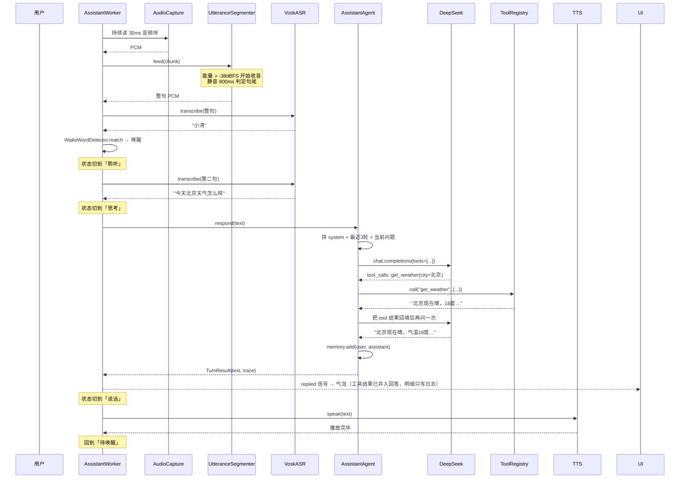

# 架构说明

## 1. 分层

```
┌──────────────────────────────────────────────────────────────┐
│                      界面层 (PySide6)                         │
│  MainWindow ── StatusPill / Waveform / ChatView / 设置对话框   │
└───────────────┬──────────────────────────────────────────────┘
                │ Qt Signal（跨线程，队列投递）
┌───────────────▼──────────────────────────────────────────────┐
│                 编排层 AssistantWorker (QThread)              │
│  状态机：待唤醒 → 聆听 → 思考 → 说话 → 待唤醒                  │
└───┬──────────┬──────────┬──────────┬──────────┬──────────────┘
    │          │          │          │          │
┌───▼───┐ ┌────▼───┐ ┌────▼────┐ ┌───▼────┐ ┌───▼─────┐
│ audio │ │ wake   │ │ asr     │ │ agent  │ │ tts     │
│ 采集  │ │ 唤醒   │ │ 识别    │ │ 对话   │ │ 朗读    │
│ VAD   │ │ 匹配   │ │ Vosk    │ │ 记忆   │ │ Edge    │
└───────┘ └────────┘ └─────────┘ │ 工具   │ │ 离线语音 │
                                 └───┬────┘ └─────────┘
                                     │
                     ┌───────────────┼───────────────┐
                     ▼               ▼               ▼
                 memory.py       llm.py          tools.py
               最近 3 轮     DeepSeek/Mock   天气/时间/计算
```

**依赖方向是单向的**：界面 → 编排 → 业务。业务层不 import Qt，`agent.py` 甚至不 import 音频，
所以 `tools/smoke_test.py` 可以脱离界面和麦克风直接测对话、记忆、工具。

## 2. 一次语音问答的时序



## 3. 状态机

| 状态 | 进入条件 | 做的事 | 离开条件 |
|------|---------|--------|---------|
| 待唤醒 | 启动完成 / 回答结束 | 收音频、切句、识别、匹配唤醒词 | 匹配到唤醒词，或点击底部「说话」 |
| 聆听 | 唤醒成功 / 点底部「说话」 | 收下一句，识别成文字 | 收到一句话；或再点「说话」/ 30s 没声音（回待唤醒） |
| 思考 | 拿到用户文本 | Agent：记忆 + 模型 + 工具循环 | 拿到最终回答 |
| 说话 | 有回答且开启了 TTS | 播放语音，期间丢弃麦克风数据防回声 | 播放结束 |
| 离线 | 初始化失败 | 只显示错误 | 重启程序 |

VAD 的两个阈值是**滞回**的（开始 -38dBFS、持续 -46dBFS），避免一句话被切成几段；
收音时保留 200ms 预录，避免第一个字被吃掉。

唤醒后先播一句应答（"我在呢"之类，可配置、可关闭），再进入聆听，对应状态机里一段短暂的
「说话 → 聆听」；应答语音是固定话术，第一次合成后会落盘缓存（`EdgeTTS.speak_cached`），
之后唤醒直接播放。一句话唤醒+指令（"小清，今天天气"）则不插应答，直接回答。

TTS 后端失败只进 60 秒冷却、不永久剔除：Edge 掉线时会立刻换 Windows 离线语音并提示，
网络恢复后自动回到 Edge。

## 4. 工具调用循环

```
messages = [system] + 最近3轮 + [当前问题]
for step in range(3):
    reply = llm.complete(messages, tools)
    if reply 没有 tool_calls: return reply.content
    messages += assistant(tool_calls)
    for call in reply.tool_calls:
        result = registry.call(call.name, call.arguments)   # 真正执行
        messages += tool(result)
# 防死循环：最后一次不带 tools 强制模型给结论
return llm.complete(messages, tools=None).content
```

新增一个工具只需要：

1. 写一个返回 `str` 的函数（参数用中文描述清楚）；
2. 在 `build_default_registry()` 里 `registry.register(ToolSpec(...))`。

模型的 schema 由 `ToolSpec.schema()` 自动生成，界面轨迹也会自动显示。

## 5. 记忆

`ConversationMemory` 用 `deque(maxlen=3)` 存"轮"：每轮一个 user + 一个 assistant。
每轮请求都重建 messages（system + 历史 + 当前），所以上下文始终只有最近 3 轮，
既满足题目要求，也控制住了 token。

## 6. 降级链

| 环节 | 首选 | 失败后退到 | 界面提示 |
|------|------|-----------|---------|
| 识别 | Vosk 本地模型 | 演示台词（MockASR） | 「已降级为演示识别」 |
| 大模型 | DeepSeek | 离线演示模型（MockLLM） | 「没有配置 API Key…」 |
| 朗读 | Edge-TTS | Windows 离线语音（PowerShell 调 System.Speech）→ 静默 | 侧栏「播报」显示实际后端，降级时状态栏提示 |
| 麦克风 | sounddevice 采集 | 只打字 | 「麦克风不可用（可打字）」 |

## 7. 线程与信号

- `AssistantWorker.run()` 里串行执行：读音频 → VAD → 识别 → 模型 → 朗读；
- 界面线程通过 `submit_text()/request_listen()/reset_memory()` 往 `queue.Queue` 投命令，
  工作线程每轮循环取一次，避免跨线程直接改对象；
- 工作线程只通过 `Signal` 通知界面：`state_changed / level_changed / user_said / replied / notice / memory_changed`，
  气泡朗读另有 `speech_started / speech_finished`（带 token，界面据此把 🔊 变成 ⏹）。
- 停止朗读有两个入口：气泡上的喇叭（再点一次即停）、朗读中点底部「说话」按钮（先打断再开始听）。
  朗读跑在独立线程里，带按字数估算的超时看门狗；音频设备卡死时超时强停，状态和按钮一定能回来。

## 8. 评分点对照

| 评分项 | 对应实现 |
|--------|---------|
| 功能全跑通 | 语音/打字两条入口都走同一套 Agent；工具、记忆、朗读、界面全链路 |
| 代码结构清晰 | core 分层 + 接口抽象 + 工厂降级 + 分层自检脚本 |
| 本地模型加分 | Vosk 本地识别（离线）、可选 Ollama 本地大模型 |
| 创新点 | 唤醒词/别名/阈值均可改；一句话唤醒+指令；唤醒应答可配置；工具调用明细入库日志 |
| 体验自然 | 深色界面、实时波形、状态胶囊、思考占位、朗读防回声、Edge 神经语音 |
